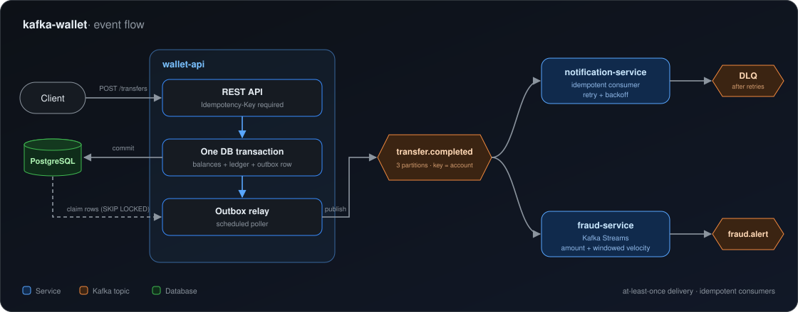

-2ea043?style=for-the-badge)

**Computer Science student at UNISC** · Portuguese (native) · English (C1)

[LinkedIn](https://linkedin.com/in/alec-knipphoff-da-cruz-155358314) · [Email](mailto:alecknipcruz@gmail.com)

---

### 👋 About

I build backend systems where correctness matters: authentication, onboarding/KYC and event-driven services. At KTO, an iGaming platform, I worked on exactly that. On my own time I build projects that stress the hard parts of distributed systems (duplicate delivery, partial failure, ordering) and write down the trade-offs I made.

---

### 🔎 What I'm looking for

| | |
| --- | --- |
| **Role** | Java Backend Developer, junior or mid-level |
| **Stack** | Java, Spring Boot, PostgreSQL, Kafka, and AWS. I'd especially like a role that takes me deeper into cloud (AWS) |
| **Problems I enjoy** | Authentication and identity, fintech and payments, event-driven systems, reliability and clean architecture |
| **Setup** | Remote preferred. Open to Brazilian and international companies |

If your team fits, [send me a message](mailto:alecknipcruz@gmail.com) or reach out on [LinkedIn](https://linkedin.com/in/alec-knipphoff-da-cruz-155358314).

---

### ⭐ Featured project: [kafka-wallet](https://github.com/AlecKnipphoffDaCruz/kafka-wallet)

An event-driven money transfer system built to practise the problems that make Kafka hard. The business rule is deliberately trivial (move money between two accounts); the plumbing around it is the point.

  

| | |
| --- | --- |
| 📤 **Transactional outbox** | The event is published if and only if the money moved. The relay claims rows with `SELECT … FOR UPDATE SKIP LOCKED`, so it scales horizontally. |
| 🔁 **Idempotency at both ends** | A mandatory `Idempotency-Key` on the API, and consumers that deduplicate by `eventId`. |
| 🛡️ **Failure handling** | Optimistic locking with jittered retries, consumer retries with exponential backoff, then a dead-letter topic. Kafka Streams fraud rules (amount threshold and windowed velocity). |
| 🧪 **Real infrastructure in tests** | Testcontainers integration tests, including 50 concurrent transfers that must leave the ledger balanced. |
| 📈 **Observable** | Prometheus and Grafana, with outbox backlog and consumer lag as the key panels. |
| 📝 **Trade-offs written down** | Every design decision and known limitation (poller vs CDC, no auth, single broker) is documented in the repo. |

---

### 📦 More projects

<table>
  <tr>
    <td width="50%" valign="top">
      <h4><a href="https://github.com/AlecKnipphoffDaCruz/platform-gitops">platform-gitops</a></h4>
      Kubernetes and GitOps lab: a local k3d cluster managed by Argo CD (App of Apps), with two apps in separate repos whose GitHub Actions pipelines build multi-arch images and promote them via Git. A push becomes a deploy with no manual <code>kubectl</code>.
    </td>
    <td width="50%" valign="top">
      <h4><a href="https://github.com/AlecKnipphoffDaCruz/-hexagonal-structure-practice">hexagonal-structure-practice</a></h4>
      Ports &amp; Adapters reference implementation with Spring Boot and Java 25, with the rules for what may and may not cross each boundary.
    </td>
  </tr>
  <tr>
    <td width="50%" valign="top">
      <h4><a href="https://github.com/AlecKnipphoffDaCruz/java-desing-patterns">java-desing-patterns</a></h4>
      Factory, Singleton, Builder, Strategy, Observer and Decorator, each with a backend-flavoured example.
    </td>
    <td width="50%" valign="top">
      <h4><a href="https://github.com/AlecKnipphoffDaCruz/aws-clf-02">aws-clf-02</a></h4>
      Bilingual (PT/EN) study guide for AWS Cloud Practitioner (CLF-C02): 27 sections, comparison tables, diagrams and exam-trap callouts. Written while preparing for the exam, which I passed.
    </td>
  </tr>
  <tr>
    <td width="50%" valign="top">
      <h4><a href="https://github.com/AlecKnipphoffDaCruz/leetcode">leetcode</a></h4>
      LeetCode solutions in Java.
    </td>
    <td width="50%" valign="top"></td>
  </tr>
</table>

---

### 🛠️ Tech

  

**Also:** Keycloak · OAuth2 / JWT · REST APIs · Flyway · Testcontainers · Kafka Streams · Prometheus + Grafana · Argo CD / GitOps · Kustomize · Hexagonal architecture · Design patterns

---

### 🎯 Currently

- 📚 Studying for **AWS Certified Solutions Architect – Associate**
- ☸️ Practising Kubernetes and GitOps with Argo CD in [platform-gitops](https://github.com/AlecKnipphoffDaCruz/platform-gitops)
- 📚 Spring Security and system design
- 🗣️ Practising technical interviews in English
- 🔨 Polishing my repositories and documenting the decisions behind them

### 💼 Experience

**Technology Apprentice, KTO** (iGaming platform), until Oct 2026
Authentication and onboarding services with Spring Boot, Keycloak and Kafka, using hexagonal architecture.

### 🏅 Certifications

-FF9900?style=for-the-badge&logo=amazonwebservices&logoColor=white)

---

### 📫 Let's talk

